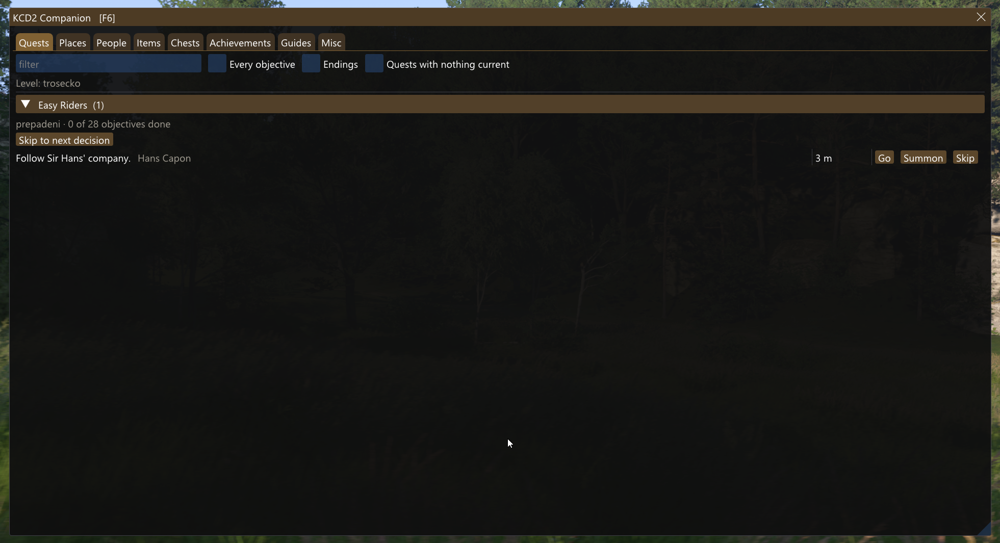
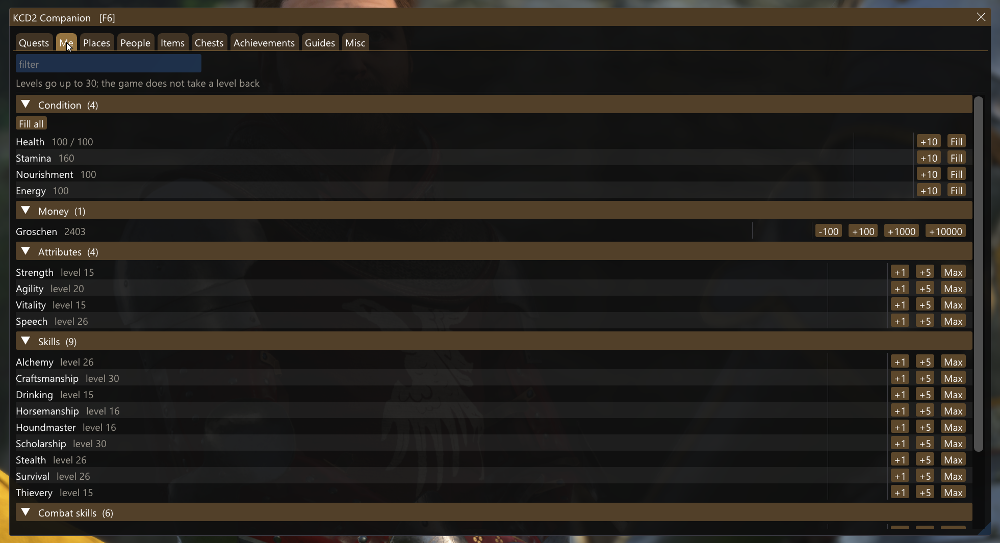
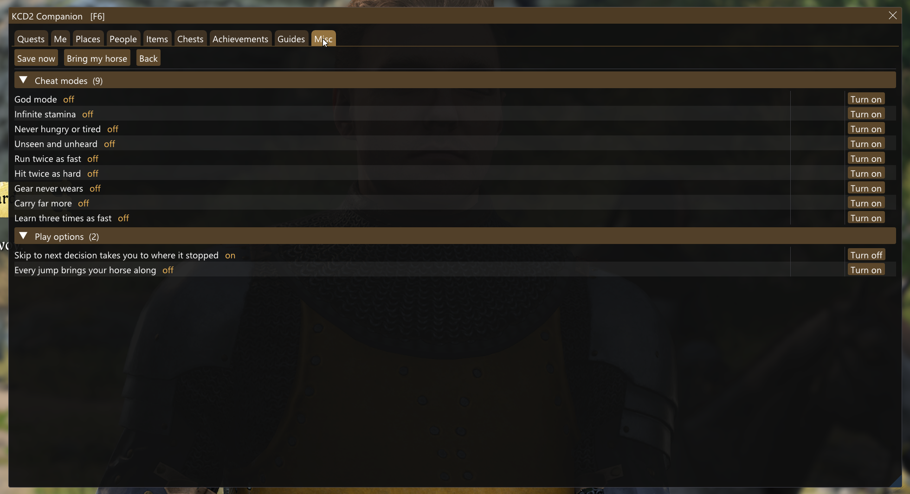
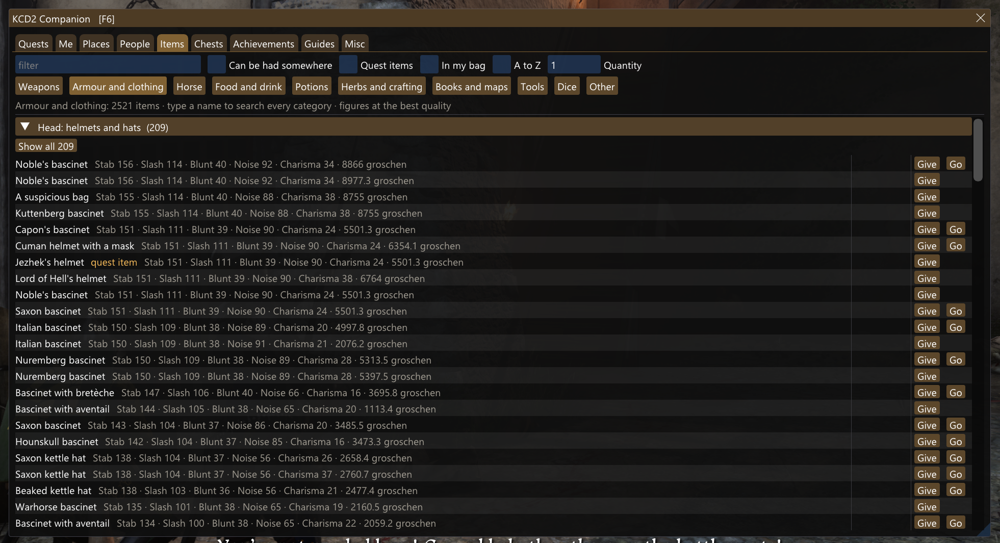
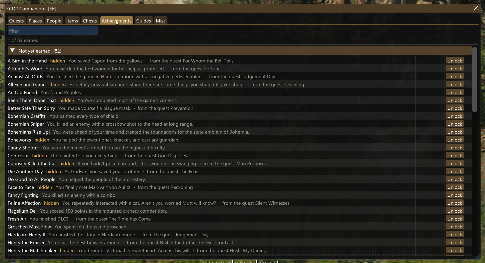

# KCD2 Companion

The full suite for **Kingdom Come: Deliverance II**, in one window inside the game (**F6**) or a browser panel on a second screen. **Quests**: go straight to your current objective, or skip the busywork up to the next real decision. **Items**: give yourself any of the game's 5,120 items, or go to where one is sold or lying. **Achievements**: see which of the 83 you have and the quest that grants each, and unlock any of them. Then Henry's stats, skills and money, nine cheat modes, and every person, place and chest around you. The decisions stay yours: an objective that can end more than one way shows each ending, and the mod never picks one.

| | |
|---|---|
|  |  |
|  |  |

## Features

- **Quests**: every current objective with **Go** (to its marker), **Summon** (when the marker is a person) and **Skip** (through the quest's own trigger, so the game's consequences run). **Skip to next decision** completes busywork one step at a time and stops at a decision, a conversation or a scene, then takes you there. Views of every objective and every open ending.
- **Items**: all 5,120 items; **Give** any quantity; **Go** to the shops, chests and spots one can be had, nearest first.
- **Achievements**: all 83 Steam achievements with your earned state, each with the quest that grants it where the game says; **Unlock** sets an unearned one on your Steam account.
- **Me**: health, stamina, nourishment and energy (refill one or all), groschen in steps up to +10,000, the four attributes and fifteen skills (+1 / +5 / Max).
- **Misc**: Save now (no schnapps), Bring my horse, and nine **cheat modes**: God mode, Infinite stamina, Never hungry or tired, Unseen and unheard, Run twice as fast, Hit twice as hard, Gear never wears, Carry far more, Learn three times as fast.
- **People**: everyone loaded around you, by in-game name, with Go and Summon.
- **Places**: villages, towns, monasteries and camps with their shops, smithies, alchemy tables, grindstones, baths, barbers and beds; **Mark** and **Back**.
- **Chests**: every container in the level, locked ones marked.
- **Views** on every long list: items that can be had somewhere, quest items, what is in your bag, most valuable first; locked, unlocked or stocked chests; people within 50 m; shops or services only.
- **F8** goes to the tracked quest's nearest current objective.
- Jumps work on foot and on horseback, land on the floor under roofs and trees, and never inside a trigger area.
- **Languages**: English and Chinese for now, picked by your game's language setting; names, objectives and journal lines always come from the game's own text, in whatever language it runs.

## Install

**Installer**: download **`KCD2-Companion-1.0.0-Installer.exe`** from the [latest release](../../releases) and run it. It finds the game through Steam (or paste the game folder), installs with one click, updates and uninstalls, and shows the panel in its own window while the game runs. Windows may warn about an unknown publisher: More info > Run anyway.

**Manual**: download **`KCD2-Companion-1.0.0.zip`** from the same release and extract it into the game folder (Steam: right-click the game > Manage > Browse local files), keeping its folders. Start the game and load a save; press **F6**, or open **http://127.0.0.1:17602** in a browser on the same PC. `INSTALL.txt` in the zip lists every file it adds; deleting them uninstalls it.

Also on Nexus Mods: https://www.nexusmods.com/kingdomcomedeliverance2/mods/3812

## Compatibility

Built and tested on Steam build **1.5.6** (23914554). The plugin reads the game's quest objects at fixed offsets, so a game update may need a rebuilt plugin. Test on a copy of your save first.

## Kingdom Come: Deliverance (the first game)

The first game's trainer is **Quest Autopilot** on Nexus Mods: https://www.nexusmods.com/kingdomcomedeliverance/mods/2226. Its full version, with the same window, panel and tabs as this one, will be released as **KCD Companion**.

## Credits

Original mod code. The cheat modes' buff technique (a mod's own `buff__<mod>.xml` and the engine's stat codes) follows [kcd2-cheat](https://github.com/pryans/kcd2-cheat). Uses Ultimate ASI Loader (MIT) to load the plugin, Dear ImGui (MIT), MinHook (BSD-2), nlohmann/json (MIT) and kcd2db's CryEngine headers (MIT). Not affiliated with Warhorse Studios or Deep Silver.
